# Dolores Hoy

Flutter + 5 APIs gratuitas con buenas prácticas de seguridad: Clima, Tipo de cambio, Festivos, Wikipedia y NASA.

Desarrollo Móvil Integral · UTNG

Autor: Aguilar Ortiz Gael Alejandro

Grupo: GTID241 · Matrícula: 1225100273

## Capturas

### Ronda 0 · Preparar el taller
#### Secretos fuera del repositorio
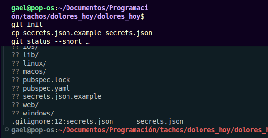

### Ronda 1 · Conociendo las 5 APIs
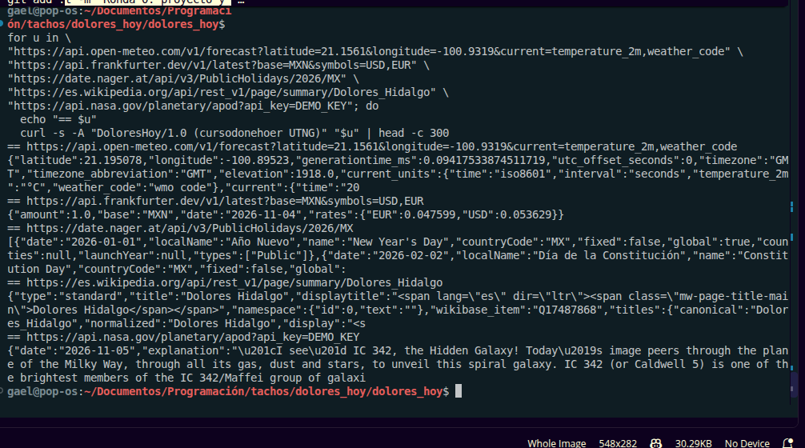

### Ronda 2 · Cimientos seguros: ClienteSeguro
#### Rojo
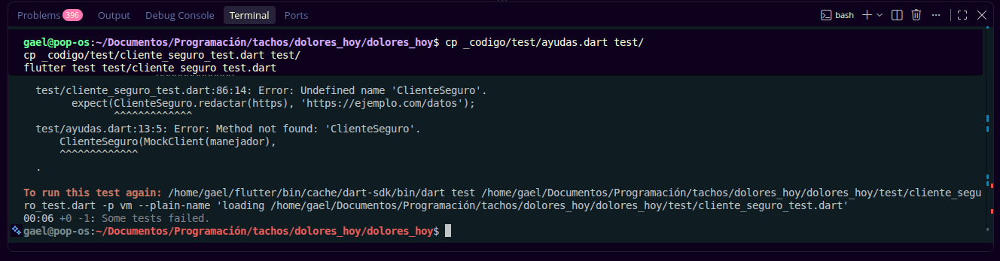
#### Verde
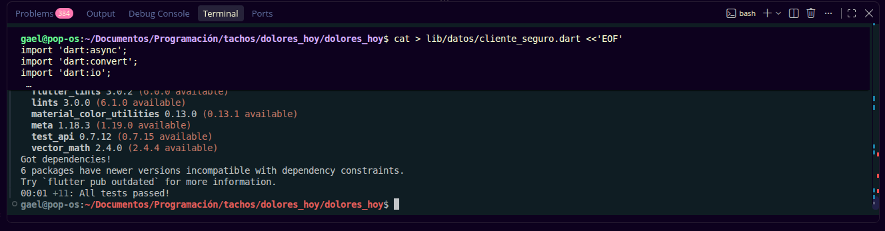

### Ronda 3 · API 1: Clima (Open-Meteo)
#### Rojo
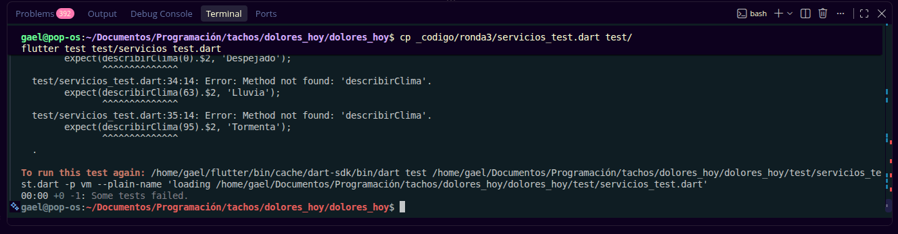
#### Verde
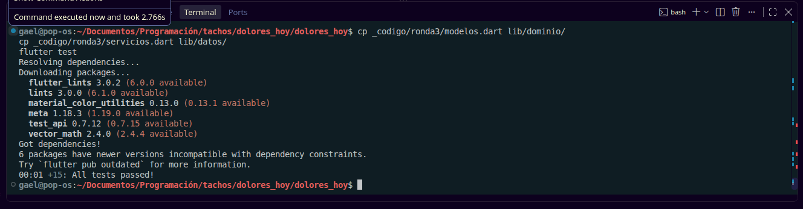

### Ronda 4 · API 2: Tipo de cambio (Frankfurter)
#### Rojo
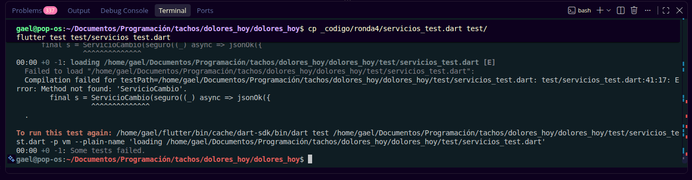
#### Verde
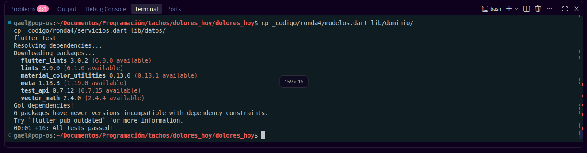

### Ronda 5 · API 3: Días festivos (Nager.Date)
#### Rojo
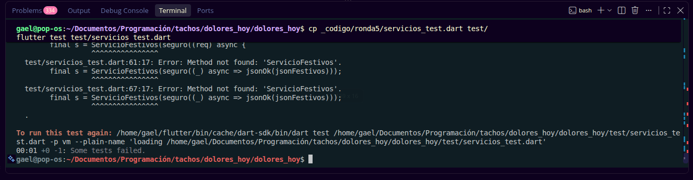
#### Verde
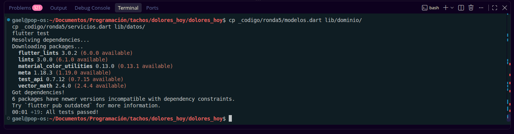

### Ronda 6 · API 4: Wikipedia
#### Rojo
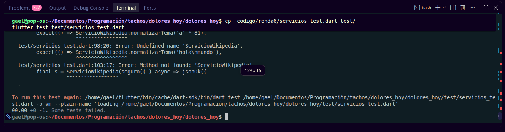
#### Verde

### Ronda 7 · API 5: NASA y manejo seguro de claves
#### Rojo
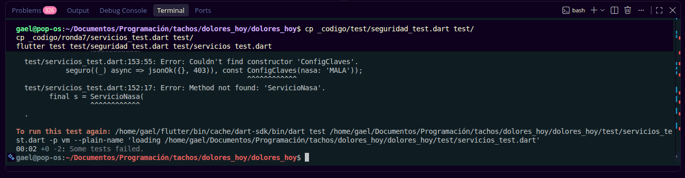
#### Verde
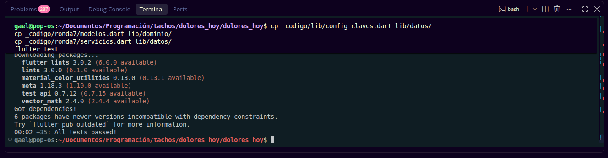

### Ronda 8 · El tablero: 5 APIs independientes
#### Rojo
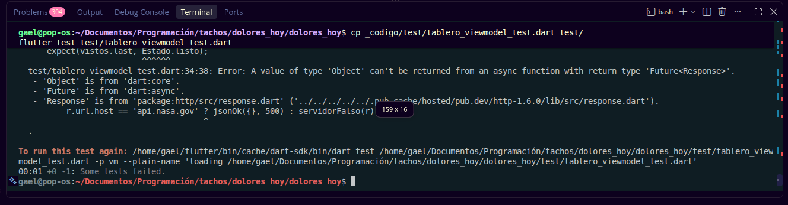
#### Verde
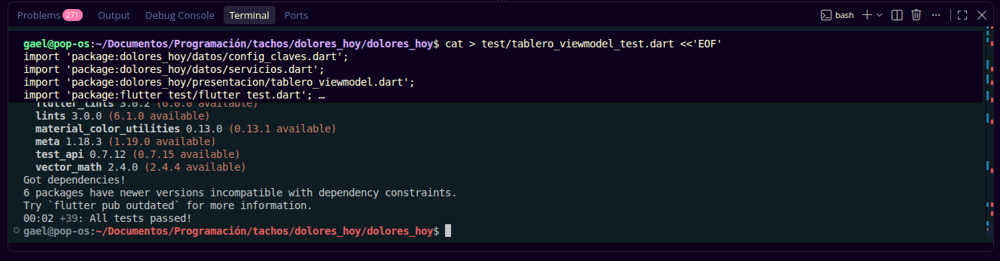
